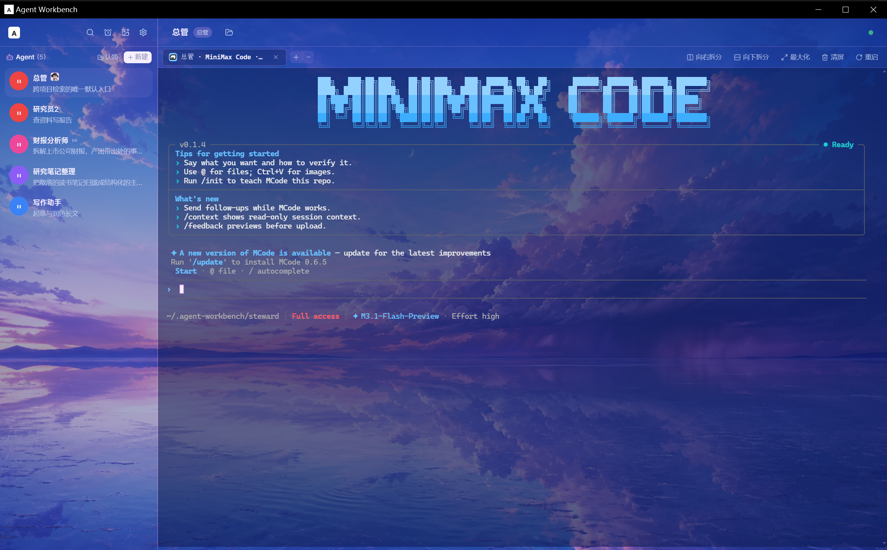

# Agent Workbench

本地个人统一工作台 —— 一个界面，多种视图，多家 agent 工具平等切换。



---

## 开源许可

本项目以 [MIT](LICENSE) 协议开源。

 incorporation 的第三方代码与资产（含移植与图标）的著作权与许可声明，
见 [`THIRD-PARTY-NOTICES.md`](THIRD-PARTY-NOTICES.md)。设计层面的参照
（对齐/借鉴的架构与交互思路）不构成代码复制，出处以注释与
[`docs/05-reference-map.md`](docs/05-reference-map.md) 为准。

---

## 快速开始

**根目录一条命令起全栈**（前端 5280 + daemon 5281）：

```bash
pnpm install    # 只需在根目录跑一次，装 concurrently
pnpm dev        # 同时起前后端，Ctrl+C 一起停
```

启动后打开 <http://127.0.0.1:5280/>。日志带 `[web]` / `[daemon]` 前缀区分。

其他命令：

```bash
pnpm dev:web      # 只起前端
pnpm dev:daemon   # 只起 daemon
pnpm build        # tsc -b && vite build
pnpm typecheck    # 前后端一起查
pnpm smoke        # daemon Phase 0 冒烟
```

**daemon 必须起着，否则应用是空的。** 这是 2026-09-30 有意去掉的 mock 兜底
（提交 `d9a8e7d`：「mock 数据影响判断，直连后端看真实效果」）：
daemon 不可达时执行器清单为空，不再注册六家假执行器撑门面。

daemon 起来后前端会连上并打印：

```
[workbench] 已连接本地 daemon：zcode, codex, claude, pi, mcode, dsh, opencode, mockperm
```

八家执行器三种接入形态：claude/codex/pi 走一次性进程（每轮 spawn CLI 翻 JSONL），
zcode/mcode/dsh 走常驻 stdio 协议进程（`mcode acp` / `dsh acp`，带真权限审批流），
opencode 走常驻 HTTP server（`opencode serve` + SSE，t3code 同款，真 patch diff），
见 `docs/03` §3.3.1。

**有执行器 ≠ 有内容。** 侧栏单元来自各 bot 工作目录下的 `.agent-workbench/bot.json`
（bot.json 是家，store 只是运行态视图）。没建过 bot 就没有 bot.json，侧栏就是空的——
这属于正常首启状态，不是故障。

**用 `127.0.0.1` 而不是 `localhost`。** Vite 在 Windows 上默认只绑 IPv6 `::1`，
本地浏览器工具连不上。配置里已显式绑 IPv4。

需要「真实节奏」演示（事件逐条浮现而非一次性铺满）：

```
http://127.0.0.1:5280/?pace=350
```

---

## 技术栈

```
Vite 7 + React 19 + TypeScript 5.9 + Tailwind CSS v4 + Zustand 5 + Electron（P2）
                            ↓
                  自研 RuntimeAdapter SPI（纯 TS，零框架依赖）
```

**不 fork 任何参考仓库。** 全新写渲染层，四家只当运行时接进来。

完整论证见 [`docs/01-tech-stack.md`](docs/01-tech-stack.md)。

---

## 参考与致谢

本项目**不 fork 任何参考仓库**，但架构、交互与视觉大量参照了开源社区的成果。
代码中以 `对齐 ××` / `借鉴 ××` / `移植自 ××` 注释标注出处（200 余处）；
「每个功能 → 参照来源 → 落点」的完整地图见
[`docs/05-reference-map.md`](docs/05-reference-map.md)，
起步时四家仓库的代码走查实证见 [`docs/02-reference-audit.md`](docs/02-reference-audit.md)。

### 架构与实现参照

| 仓库 | 许可证 | 参照内容与主要落点 |
|---|---|---|
| **ZCode**（`zocdeusual/ZCode`） | Apache-2.0 | 外壳骨架总蓝本：Shell 布局「收起即归零」、设置覆盖层、命令中心、自动化页两条口径、空态原则（功能不因空而消失） |
| **t3code**（T3） | MIT | 供应商实例管理（ProviderInstancesPanel）、模型偏好系统（隐藏/排序/自定义模型）、harness 品牌图标、opencode 接入形态（serve + SSE） |
| **deepseek-harness**（dsh） | MIT | 轨迹账本与轮次头、会话内页签、StatsPills/ModelsSection；其 ACP 协议实现是 dsh/mcode/hermes/kimi 四家 acp 接入的参照 |
| **waku / waku-agent**（Sean Chen / ShenSeanChen） | MIT | 记忆三柱（语义事实/情节事件/程序性技能）与编排、管家（steward）机制 |
| **pi-hermes-memory**（Chandra Teja） | MIT | 记忆安全扫描器的威胁模式移植（prompt 注入 / 角色劫持拦截）→ `backend/src/memory/scanner.ts` |
| **pi**（badlogic/pi-mono） | MIT | 供应商目录、models.json 配置形态 |
| **Codex-Dream-Skin**（Codex Dream Skin Studio） | MIT | 外观系统契约：theme.json 十组色、safe-css 变量域、透明度方向与「只染背景不染文字」的钉死行为 |
| **gpt_image_playground**（CookSleep） | MIT | 出图工作台全链路移植（images/responses 双模式、SSE 解析、供应商映射） |
| **cherry-studio** | GPL | **只看思路未抄码**：dsh SDK 进程内嵌形态的对比参照，最终选了 ACP；借鉴「resume token 事件化」 |
| **VS Code** | MIT | 终端集成模式（terminalInstance / xtermTerminal 的会话持久化与分屏） |
| **OpenClaw**（OpenClaw Foundation） | MIT | 渠道插件抽象（ChannelPlugin）与渠道编排 |
| **GrokBot / Meta Muse** | 闭源 | 侧栏彩色 blob 头像、时间线思考折叠与工具卡片、行结构与相对时间 —— **仅视觉与交互参照，未复制任何代码或资产** |
| **WeKnora**（Tencent） | MIT（含第三方组件声明） | 记忆后端渠道之一（知识库 listKb / saveFact / search 客户端为自写实现） |
| **agents.md 规范**（OpenAI） | MIT | bot 岗位说明书（AGENTS.md）格式 |

### 接入的开源 Agent CLI（执行器）

`zcode` · Claude Code · OpenAI Codex CLI · `pi`（@earendil-works/pi-coding-agent）·
MiniMax Code（`mcode`）· DeepSeek Harness（`dsh`）· OpenCode · Hermes · Kimi Code（`kimi`）

三种接入形态：一次性进程（每轮 spawn CLI 翻 JSONL）、ACP 常驻 stdio 子进程、
常驻 HTTP server + SSE（见 `docs/03` §3.3.1）。

### 关键开源依赖

React 19 · Vite 7 · TypeScript · Tailwind CSS v4 · Zustand 5 ·
`@xterm/xterm` · `react-resizable-panels` · `lucide-react` · Electron · tsx

---

## 文档

| 文件 | 内容 |
|---|---|
| [`docs/00-north-star.md`](docs/00-north-star.md) | 需求与北极星。技术选型服务于它 |
| [`docs/01-tech-stack.md`](docs/01-tech-stack.md) | **主文档**：逐层选型、为什么不选什么、许可证核查、分阶段路线 |
| [`docs/02-reference-audit.md`](docs/02-reference-audit.md) | 四个仓库的代码走查实证 |
| [`docs/03-architecture.md`](docs/03-architecture.md) | 三层架构、SPI 契约、两个必须记住的坑 |
| [`DESIGN.md`](DESIGN.md) | **视觉规范**（中性灰阶 + 单一青色，2026-10 重写） |
| [`docs/04-design-system.md`](docs/04-design-system.md) | **设计落地**：token、组件映射，以及我在 6 处偏离 DESIGN.md 的理由 |

---

## 目录结构

```
agent-workbench/
├── docs/                    设计文档
└── prototype/               可跑的 UI 原型
    └── src/
        ├── core/            零厂商依赖的领域层 + SPI
        │   ├── units.ts     WorkUnit / Session / Deliverable
        │   ├── events.ts    RuntimeEvent union + TraceRecord
        │   ├── adapter.ts   RuntimeAdapter SPI + Capabilities
        │   └── registry.ts  RuntimeRegistry
        ├── adapters/
        │   └── mock/        六家工具的假实现
        ├── store/           zustand
        └── ui/              组件
```

依赖方向严格单向向下：`ui/ → core/`，`adapters/ → core/`，`core/` 不 import 任何东西。

---

## 视觉

**中性灰阶 + 单一青色强调 + 完全扁平。** 设计令牌集中在 `src/styles.css` 的 `@theme`，
**改配色只改那一个块**。

```
canvas #fafafa   rail #f4f4f4   card #ffffff   line #e4e4e4
ink    #0a0a0a   graphite #525252   ash #8a8a8a
teal   #016a71   ← 全场唯一 UI 彩色
```

**卡片是纯白，���布是浅灰** —— 靠明度差浮起，不靠阴影。全场只有一道 `0 1px 2px / 6%`。
字重锁死 400/500，最小字号 11px。

**允许存在的彩色只有三类，且都是数据不是装饰**：六家执行器的品牌色（20px 身份徽标）、
bot 身份色（由名字哈希出的「颜色 × 形状」）、任务分组色。
判据是「换掉它用户就认不出那是谁」；任何「让页面好看一点」的彩色都不允许。

规范全文见 [`DESIGN.md`](DESIGN.md)。
> 该文件 2026-10-02 整体重写，上一版（Perplexity 羊皮纸）已作废。

---

## 交互约定

| 操作 | 键位 |
|---|---|
| 发送 | `Enter` |
| 换行 | `Shift + Enter` |
| 搜索 | `⌘F` |
| 命令面板 | `⌘K` |
| 终端面板 | `` ⌘` `` |

## 面板（对齐 ZCode）

| 面板 | 入口 | 对齐要点 |
|---|---|---|
| 会话 | 默认主视图 | ZCode 的 `workspaceMainView: chat` |
| 自动化 | 侧栏底 / 命令 | `AutomationsSection`：双 tab + 四档状态筛选 + 卡片网格 |
| 设置 | 侧栏底 / 命令 | `settingsPageConfig` 三组导航 + `SettingsRow` / `GroupCard` |
| 搜索 | 侧栏底 / `⌘F` | 合并 ZCode 分散的 TaskFind / 会话查找 / 命令搜索 |
| 权限对话框 | 自动弹出 | `PermissionDialog`：编号选项 + 选中后统一确认 |

**主视图切换**（`chat` / `automations` / `settings` / `search`）共享同一套外壳，
对齐 ZCode 把「设置」和「自动化」都当主视图而非弹层的处理。

> **右侧标签面板已整体移除**（2026-10，用户决策：这个产品不要右栏）。
> `core/sidepane.ts`、`store/useSidePane.ts`、`scripts/check-sidepane.ts` 与
> 命令面板里那条「展开 Agent 档案」入口一并删除 —— 它当时只切换一个没人渲染的状态。
> 要重新引入，从 git log 取（`588d458` 有完整契约与 95 条断言）。

空状态是建议卡片，点一下直接填入输入框并聚焦。
权限卡裁决后会折叠成一行回执（`✓ 写入 xxx · 已允许一次`），不留悬空的按钮。

## Composer 的左右分工

对齐 ZCode 的 `V4ComposerToolbar`：左右各管一件事，不混。

```
📎 @ [n]                    ⋯运行配置        发送
↑ 带什么                      ↑ 这条消息怎么跑（点开才展开）
```

**左侧**只放输入相关的（附件、引用）。
**右侧**放运行配置。发送是唯一常驻的实心按钮。

### 渐进披露：功能按需出现（第一批）

> 对标 Grok @Bot 的设计哲学——**「最好的 UI 就是没有 UI」**。
> 本项目的落地口径：**不用时不占版面，不是功能消失。**

原先 composer 右缘常驻三枚带文字的按钮（权限模式 / loop 参数 / 执行器），
但这三项一个会话内基本不动。收进一颗 `⋯`（`RunConfigMenu`）之后，
点开是一个三行手风琴，**每行折叠时照样显示当前值**——打开一次就能扫完现状。

| 收起了什么 | 唤出入口 | 什么时候出现 |
|---|---|---|
| 终端 / 轨迹 / Ops 三个视图 | 页签行 `⋯` | 「对话」外的视图才显示；切过去后 `⋯` 变成当前视图名 |
| 权限模式 / loop 参数 / 执行器模型 | composer `⋯` | 调运行配置时 |
| 新建任务 / 搜索 / 自动化 / 出图（第二、五批） | 常驻，四枚等宽图标平铺，无 `⋯` | —— |
| 已归档（第五批） | 顶栏第 5 枚图标，点开列归档 | 回溯入口，非空时挂角标 |
| 任务分组（第六批） | **已删除** | 原为纯 UI 壳（按钮无 onClick、无 store 状态、样例数组从未被 import）|
| 右侧标签面板（第七批） | **已删除** | 同属"没人渲染的壳"，见上面「面板」一节 |
| 组织方式 / 排序（第二批） | 身份行 `⚙` | 改视图偏好时 |
| 底部统计坞（第一批） | 无（自动） | 有事件流数据或正在运行时才渲染 |

**按频次分级，不是按重要性**——这是第二批确立的口径：

- **高频**（工作单元切换、新建任务）→ 常驻可见；
- **低频偏好**（组织方式、排序）→ 收进浮层，当前值带在 title / 折叠行里；
- **低频导航**（搜索、出图、自动化）→ **去掉文字留图标，不藏进浮层**。
  浮层是给「偶尔才改的偏好」用的，导航入口收进去就等于藏起来了。

**危险档不参与隐藏。** 「完全放行」一旦点下，后面所有授权框都不再出现，
所以 `⋯` 触发器在该档**常驻警示色**——这是整条 composer 上唯一不收起的风险提示。

> 这条不改 README 里「功能不能因为『当前为空』就消失」那条原则的**精神**：
> 四个视图在 `⋯` 里全部列出，收起的只是版面，不是入口。

> 「更好效果 / 更短时间 / 更低成本」曾是第一轮需求里混进来的概念，
> 已连同 `StartSessionRequest.strategy` 一起从 UI 和 SPI 移除。
> 全文检索无残留。若将来真要做多 agent 编排策略，从这里重新加回成本很低。

### 权限模式

`core/permission.ts`，四档对齐 Claude Code / Codex / ZCode 通用约定：

| 模式 | 读 | 写 | 命令 |
|---|---|---|---|
| 默认询问 | 允许 | 询问 | 询问 |
| 自动接受编辑 | 允许 | 自动 | 询问 |
| 只读规划 | 允许 | 拦截 | 拦截 |
| 完全放行 | 允许 | 自动 | 自动 |

**权限模式和权限对话框是两层东西**：
模式是本次运行**预先声明**的默认策略，作用于所有后续请求；
对话框是单个请求的**具体裁决**，只在需要问的时候出现。

两者通过 `needsDialog()` 联动 —— 切到「完全放行」后对话框不再出现，
而不是变成一个空壳；切到「只读规划」后措辞变成「只读模式已拦下」，
且不提供任何可授权的选项。

「完全放行」在选择器里用警示色标出，因为它一旦点下去，
后面所有授权框都不再出现，用户必须当场知道自己关掉了什么。

### 右侧面板（已移除）

这一节原先记的是右栏标签面板的七条行为约定（可见性作用域、关激活页落右邻、
重排不动焦点、总览搜索评分、最近关闭存完整 tab、溢出判定与常驻挂载）。
**面板本身与它的契约模块已在 2026-10 整体删除** —— 它早就没挂进界面，
只留下一堆没人渲染的状态和一个切换空气的命令。原实现与 95 条断言见 git log
（`588d458` 之前）。要重做，照那七条重新落一遍即可，比修一堆死代码便宜。

## 侧栏：五枚图标 + 单元列表

对齐 ZCode `WorkspaceSidebar` 的完整能力集。
**一条原则：功能不能因为「当前为空」就消失。**
另一条：**收起的是版面，不是入口**——判据是使用频次，不是功能重要性。

现在的结构，从上到下只有四段：

```
[＋] [🔍] [⏰] [🖼] [📦]         ← 新建任务 / 搜索 / 自动化 / 出图 / 已归档，等宽平铺
[ bot | 项目 ]  0            ⚙   ← 身份切换 / 组织方式·排序
─────────────────────────
工作单元                     ＋  ← 添加就在它所属的分区标题右侧
┌ ─ ─ ─ ─ ─ ─ ─ ─ ─ ─ ┐
  还没有 bot               │     ← 空态卡，点开就是新建对话框
└ ─ ─ ─ ─ ─ ─ ─ ─ ─ ─ ┘
（单元列表，hover 出 ⚙ 设置）
```

**侧栏不设 `⋯`。** 中间试过两版：先是把任务分组 / 添加 / 已归档收进 `⋯` 浮层，
结论是**藏得太深**；再是改成底部折叠行，结论是**多占两行版面还各带一个箭头**。
最终形态是「该常驻的平铺成图标、该消失的删掉」——
已归档本身就是回溯入口，给它一枚图标（带计数角标）比给它一行更省。

| ZCode message id | 本项目落点 |
|---|---|
| `projectsSection` | 工作单元区（可拖拽排序 `reorderSection`）—— **侧栏主体** |
| `addProject` | 「工作单元」标题右侧的 `＋` + 空态卡（双入口）|
| `noProjects` | 空态卡，点击即新建 |
| `conversationsSection` / `newConversation` | 展开的会话列表 + 顶部 `＋`（⌘N）|
| `noConversations` | 「该工作单元下还没有任务」|
| `organize` / `organizeGrouped` / `viewByWorkspace` / `organizeChronologicalList` | 身份行右侧 `⚙` 浮层：组织方式 4 选 1 |
| `sortBy` / `sortByUpdated` / `sortByCreated` | 同一个 `⚙` 浮层：排序 2 选 1，当前值带在 title |
| `toggleArchivedTasks` | 顶栏第 5 枚图标 `📦`，点开列归档，非空时挂数字角标 |
| `unavailableLocalDirectory` | 「目录不可用」徽标（带样例单元）|
| 远端工作区 | 「连接远端」入口 |
| 折叠导轨 | 侧栏收起态 |

**核心动作不能只有一个入口**：「添加 bot」是这个产品的主循环，
所以标题行的 `＋` 和空态卡两处都在，共用 `useShell.addBotOpen`。


**之前的问题**：这些能力我做成了「有数据才渲染」，空数组直接不输出，
于是新增功能在页面上根本看不见。样例数据（归档会话、目录不可用单元、
任务分组）就是为了让这些状态**可被看到**。

### 自动化：两个从 ZCode 抄来的口径

1. **分组以卡片实际展示的状态徽章为准**，不是内部字段。用户在列表上看到什么颜色，
   就落在哪一组。
2. **切 tab 即回到「全部」筛选**，不恢复上次那个 tab 的旧筛选。

频率描述用**结构化 `scheduleRule`** 而非裸 cron 字符串。
只解析 cron 会把「每 30 个月」误显成「每月」、把一次性的「40 分钟后」误显成「每 1 小时」——
后者在样例数据里专门验了，显示的是「自定义」。

---

## 原型验证到什么程度

不是「能编译」，是实跑验证过的：

- ✅ `tsc -b` 与 `vite build` 均通过（383 KB / gzip 119.5 KB）
- ✅ 浏览器实跑，console 零 error / 零 warning
- ✅ 六家工具平级显示，连接状态正确（5 家 ready，dsh 演示未安装态）
- ✅ 归一化事件流端到端跑通：推理 → 消息 → 子代理 → 权限审批 → 工具调用 → diff → 用量 → 产出 → 会话结束
- ✅ **能力降级实测**：同一套 UI，切到 OpenCode（5/10 能力）后
      权限审批与结构化 diff 事件**自动不出现**，渲染层零改动
- ✅ 建议卡片 → 草稿预填 → 聚焦 → 发送，全链路可用
- ✅ 权限对话框**两步确认**实测：点未选中项只移动选中态，确认需再点「确定」
- ✅ 自动化 6 条样例覆盖全部 scheduleRule 分支，频率描述与下次运行均算对
- ✅ 搜索按 scope 分组命中，回车跳转

---

## 下一步（待你拍板）

1. **P1 先接哪个真运行时？** 建议 ZCode（HTTP 最简单，验证 SPI 成本最低）；
   若想验证「多工具平等」最有说服力的假设，则选 dsh 的 ACP
2. **何时升 monorepo？** 建议适配器超过 4 个时（预计 P3）
3. **TanStack Router 何时上？** 建议 P1 之后、Electron 之前

详见 [`docs/01-tech-stack.md` 第七节](docs/01-tech-stack.md)。
